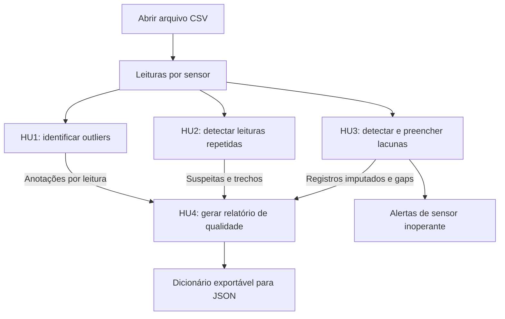

# analisador-de-sensores
Projeto Final de Engenharia de Software: Analisador de qualidade de dados de sensores (temperatura/umidade)


## Sprint 1 - Proposta

### Integrantes

<div>
Dirceu Morais da Costa Júnior<br>
Felipe Kenzo Higashi<br>
Lucas Henrique Motta
</div>

### Descrição
O sistema recebe um `.csv` na entrada com leituras de temperatura e umidade exportadas de sensores (por exemplo, ESP32).  
Ele analisa os dados em etapas com responsabilidades distintas (leitura, validação e análise) e detecta quatro tipos de problema:
- Valores fora da faixa física esperada
- Anomalias estatísticas (*outliers*)
- Lacunas de tempo entre leituras (*gaps*)
- Períodos de leituras constantes que indiquem suspeita de sensor travado (*stuck sensor*).

A saída é um relatório de confiabilidade do sensor, indicando quantos problemas foram achados, onde ocorreram e um resumo geral da qualidade dos dados.

O público-alvo são estudantes de engenharia que usam Arduino/ESP32 em projetos e pequenos produtores com estufas, que usam os sensores sem ter como verificar se os dados são confiáveis.

### Pesquisas que justificam

#### Fonte 1: Artigo brasileiro com sensores de temperatura
USBERT, Eduardo Esmínio; AMARAL, Allan Francisco Forzza; CARVALHO, Victório Albani de. **Aplicação de Técnicas de Qualidade da Informação em Sensores na Internet das Coisas (IoT)**. *Revista de Informação e Comunicação (RIC)*, Instituto Federal do Espírito Santo, p. 01-18, 2021. Disponível em: https://ojs.ifes.edu.br/index.php/ric/article/view/769. Acesso em: 30 out. 2026.

**Resumo e relevância:** O artigo investiga a qualidade dos dados de sensores em infraestruturas de IoT, contexto análogo ao de projetos com Arduino.  
Os autores afirmam que não eliminar *outliers* distorce estatísticas como média e variância e pode disparar alertas falsos.  
Um analisador que aponte valores fora de faixa, lacunas, leituras travadas e *outliers* entrega justamente a triagem que o artigo mostra ser necessária.

#### Fonte 2: Revisão sistemática (Acesso Aberto)
TEH, Hui Yie; KEMPA-LIEHR, Andreas W.; WANG, Kevin I-Kai. **Sensor data quality: a systematic review**. *Journal of Big Data*, p. 1-49, fev. 2020. Disponível em: https://journalofbigdata.springeropen.com/articles/10.1186/s40537-020-0285-1. Acesso em: 30 out. 2026.

**Resumo e relevância:** Os autores concluem que os erros mais tratados na literatura são dados faltantes e falhas como *outliers*, *bias* (desvio sistemático) e *drift* (deriva ao longo do tempo), e afirmam que aplicações IoT se tornam inúteis quando a qualidade dos dados é ruim.  
Para o nosso projeto, isso confirma que os problemas que o analisador detecta são os erros mais estudados em dados de sensores.

---

## Sprint 2 - Histórias de usuário e testes

### HU1 - Identificar outliers

Como estudante de IoT, quero identificar leituras fora do padrão usando os testes dos Quartis e de Grubbs, para evitar que esses valores prejudiquem a análise dos dados.

#### Critérios de aceitação

1. **CA1.1:** No teste dos Quartis, calcular Q1, Q3 e a amplitude interquartil (Ai = Q3 - Q1) a partir de todos os valores da variável analisada. Marcar cada valor abaixo de Q1 - 2 × Ai ou acima de Q3 + 2 × Ai como outlier; a análise não se limita à última amostra.
2. **CA1.2:** Calcular G = |leitura - média| / desvio padrão na mesma janela. Se G > 2,58, marcar a leitura como `Outlier` pelo teste de Grubbs.
3. **CA1.3:** Se nenhum dos dois testes apontar problema, classificar a leitura como `Normal`. Ela ainda pode receber suspeita de travamento pela HU2.
4. **CA1.4:** Se o desvio padrão for zero, o teste de Grubbs não deve dividir por zero nem apontar outlier. As outras análises continuam normalmente.

### HU2 - Identificar possíveis travamentos

Como usuário dos sensores, quero encontrar períodos de leituras repetidas, para verificar se algum sensor pode estar travado.

Leituras iguais geram uma suspeita, pois também podem ocorrer quando o ambiente está estável. O limite inicial de 10 leituras foi escolhido pela equipe e pode ser ajustado.

#### Critérios de aceitação

1. **CA2.1:** Analisar cada sensor em ordem de horário, separando temperatura e umidade. Contar valores numéricos exatamente iguais desde a primeira leitura, usando apenas registros originais válidos.
2. **CA2.2:** Ao atingir `MIN_LEITURAS_CONSTANTES` (inicialmente 10), marcar todas as leituras da sequência com `suspeita_travamento = True` na variável analisada. Novas repetições ampliam o mesmo trecho. Essa marcação pode existir junto com `Outlier`.
3. **CA2.3:** Encerrar a sequência quando o valor mudar, houver gap, aparecer um valor ausente ou inválido, ou terminar o arquivo. A próxima leitura original válida inicia outra sequência. Registros imputados não podem unir sequências separadas por um gap.
4. **CA2.4:** Para cada trecho, informar sensor, modelo, variável, valor repetido, horários de início e fim, duração (fim - início), quantidade de leituras e IDs dos registros. Preservar os valores e horários originais.

### HU3 - Preencher leituras ausentes

Como desenvolvedor de soluções IoT, quero detectar falhas na coleta e preencher pequenas lacunas pela média das leituras anteriores, para reduzir as interrupções na série de dados.

#### Critérios de aceitação

1. **CA3.1:** Identificar um gap quando o intervalo entre duas leituras consecutivas do mesmo sensor for maior que 15 segundos.
2. **CA3.2:** Preencher uma leitura ausente isolada com a média das 3 últimas leituras válidas anteriores.
3. **CA3.3:** Marcar os registros criados com o status `Imputado`, mantendo a identificação do sensor e sem marcar os originais como imputados.
4. **CA3.4:** Permitir o preenchimento de até 5 falhas consecutivas. Acima disso, suspender o preenchimento daquele gap e emitir o alerta `Sensor Inoperante` para o sensor afetado.

### HU4 - Resumir a qualidade dos dados

Como usuário dos sensores, quero um relatório com os problemas encontrados, para avaliar os dados e localizar os períodos que precisam de atenção.

#### Critérios de aceitação

1. **CA4.1:** Calcular o percentual de registros originais com outlier ou suspeita de travamento: registros sinalizados / total de originais × 100. Contar cada registro uma única vez, mesmo que tenha vários problemas. Excluir os imputados do cálculo. Sem registros originais, retornar `null` e indicar ausência de dados.
2. **CA4.2:** Mostrar os totais de registros originais, resultados `Normal` e `Outlier`, registros com suspeita de travamento, trechos suspeitos, gaps e imputados. Detalhar os resultados por variável e listar os trechos com os dados do CA2.4. Um registro pode contar como outlier e suspeita ao mesmo tempo. Informar que o percentual considera essas duas sinalizações.
3. **CA4.3:** Separar as estatísticas por sensor e informar seu modelo. Se houver um resumo por modelo, manter a identificação dos sensores incluídos.
4. **CA4.4:** Retornar o relatório como dicionário Python que possa ser exportado para JSON, com resultados estatísticos e suspeitas de travamento em campos separados.

### Relação com as pesquisas

As referências completas estão na Sprint 1. Usbert et al. (2021) servem de base para os testes estatísticos e para a discussão sobre qualidade dos dados. Teh et al. (2020) abordam outliers, valores constantes e dados ausentes. O percentual de registros sinalizados é uma medida definida pela equipe; os registros são preservados para consulta.

### Testes automatizados

Os testes estão em `test_analisador.py`, separados pelas quatro histórias. Os nomes e as descrições indicam os critérios verificados. Casos semelhantes usam `subTest`, como os limites de 9 e 10 leituras repetidas ou os intervalos de 15 e 16 segundos.

Para executar na pasta do projeto:

```bash
python -m unittest -v test_analisador
```

## Sprint 3 - arquitetura e desenvolvimento

### diagrama de arquitetura



### HU1: detecção de outliers

Os testes dos Quartis e de Grubbs avaliam temperatura e umidade separadamente.
Quartis usa os limites Q1 − 2 × Ai e Q3 + 2 × Ai. Grubbs sinaliza quando
G > 2,58 e não aponta outlier quando o desvio padrão é zero.

### HU2: suspeita de travamento

O analisador procura 10 ou mais valores iguais em sequência, por sensor e
variável, e marca todo o trecho. Uma mudança de valor, leitura inválida ou
lacuna acima de 15 segundos encerra a sequência. Registros imputados não
entram nessa análise.

### HU3: implementacao e validação

As funções `detectar_gaps(registros, limite_segundos=15)` e
`imputar_ausentes(registros, intervalo_segundos=10)` foram feitas em
`analisador.py`.

- Gaps sao detectados entre registros originais consecutivos **do mesmo sensor**,
  quando a diferenca de horario ultrapassa 15 segundos.
- O preenchimento usa os instantes esperados a cada 10 segundos e a media de
  ate tres valores validos anteriores por variavel (temperatura e umidade).
  Os valores validos ja imputados tambem podem entrar na proxima media.
- Cada registro criado recebe `status = "Imputado"`, `sensor_id`, `modelo`,
  `timestamp` e um `id` sintetico.
- Quando tem mais de 5 instantes faltantes no mesmo intervalo, nenhum registro
  daquele intervalo e criado e o sensor recebe um alerta
  `{"alerta": "Sensor Inoperante", "sensor_id": ...}`.
- Valores ausentes, textos invalidos, booleanos e infinitos nao entram na media.

### HU4: contrato e decisões

`gerar_relatorio(registros, trechos=None, gaps=None)`

- `registros`: leituras originais com `status_estatistico` e `suspeita_travamento` por variável, junto dos registros com `status = "Imputado"` produzidos pela HU3. <br>
Cada item representa uma leitura;
<br>a entrada deve ter IDs únicos dentro de cada sensor.
- `trechos`: lista produzida por `detectar_trechos_constantes`, com os campos do CA2.4.
- `gaps`: lista produzida por `detectar_gaps`, com `sensor_id`, `inicio`, `fim` e `duracao_segundos`.
- Omitir `trechos` ou `gaps` equivale a passar uma lista vazia.

| Campo da saída | Conteúdo |
| --- | --- |
| `registros_sinalizados_percentual` | originais com outlier ou suspeita / total de originais x 100, sem arredondar |
| `ausencia_de_dados` | `True` quando não tem originais.<br> Nesse caso o percentual é `None` (`null` no JSON) |
| `escopo_percentual` | Explicação das sinalizações feitas e da exclusão dos imputados |
| `contagem` | Originais, `Normal`, `Outlier`, não classificados, suspeitos, sinalizados, trechos, gaps e `Imputado` |
| `por_variavel` | resultados estatísticos, não classificados, suspeitas e trechos de temperatura e umidade |
| `trechos` e `gaps` | cópias dos eventos, preservando os detalhes |
| `por_sensor` | resumo de cada sensor, incluindo o modelo |
| `por_modelo` | resumo por modelo, incluindo `sensor_ids` dos sensores agrupados |

<br> **Imputados ficam fora de todas as contagens estatísticas** e de suspeita, mesmo que tenham recebido anotações (aparecem só no total `Imputado`).

A saída serializa os dados em JSON, considerando os registros e eventos no formato documentado.


### Validação

Para rodar os 31 testes das quatro histórias:

```bash
python -m unittest -v test_analisador
```

Para rodar uma história por vez:

```bash
python -m unittest -v test_analisador.TestHU1Outliers
python -m unittest -v test_analisador.TestHU2PeriodosConstantes
python -m unittest -v test_analisador.TestHU3GapsEImputacao
python -m unittest -v test_analisador.TestHU4Relatorio
```
